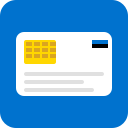

# Extension Icons

## SVG Icon (Recommended)

The extension uses **`icon.svg`** - a scalable vector graphic that works at all sizes.

### Why SVG?

According to [Mozilla's documentation](https://developer.mozilla.org/en-US/docs/Mozilla/Add-ons/WebExtensions/Your_first_WebExtension):

> "Alternatively, you could supply an SVG file here, and it will be scaled correctly."

**Benefits:**
- ✅ Scales perfectly at any size (16px to 512px)
- ✅ Sharp on high-DPI displays (Retina, 4K)
- ✅ Smaller file size than multiple PNGs
- ✅ Single file for all resolutions

### Current Icon

`icon.svg` represents an Estonian ID card with:
- Blue background (Estonian flag color)
- White card shape
- Golden chip (smart card chip)
- Text lines (personal data)
- Estonian flag accent

### Customizing the Icon

Edit `icon.svg` with any vector editor:
- **Inkscape** (free, open-source)
- **Adobe Illustrator**
- **Figma**
- **VS Code** (with SVG extension)

**Important:** If your SVG includes text, use "convert to path" to ensure consistent scaling.

## Alternative: PNG Icons

If you prefer PNG icons, create these sizes:
- `icon16.png` - 16x16 pixels (toolbar icon)
- `icon32.png` - 32x32 pixels (Windows)
- `icon48.png` - 48x48 pixels (extension management)
- `icon128.png` - 128x128 pixels (Chrome Web Store)

Then update `manifest.json`:

```json
"icons": {
  "16": "icons/icon16.png",
  "32": "icons/icon32.png",
  "48": "icons/icon48.png",
  "128": "icons/icon128.png"
}
```

## Icon Guidelines

### Design Principles
- Simple and recognizable
- Works at small sizes (16x16)
- Represents ID card or security
- Uses brand colors

### Technical Requirements
- **SVG:** Valid XML, viewBox attribute
- **PNG:** Square, transparent background
- **Colors:** High contrast, accessible
- **File size:** < 50KB for SVG, < 20KB per PNG

## Testing Icons

Test your icon at different sizes:

```html
<!-- Test in browser -->



```

All sizes should look crisp and clear.

## Resources

- [MDN: Specify icons](https://developer.mozilla.org/en-US/docs/Mozilla/Add-ons/WebExtensions/manifest.json/icons)
- [Chrome: Icon best practices](https://developer.chrome.com/docs/extensions/mv3/user_interface/#icons)
- [Material Design Icons](https://material.io/icons/)
- [SVG Optimization](https://jakearchibald.github.io/svgomg/)

